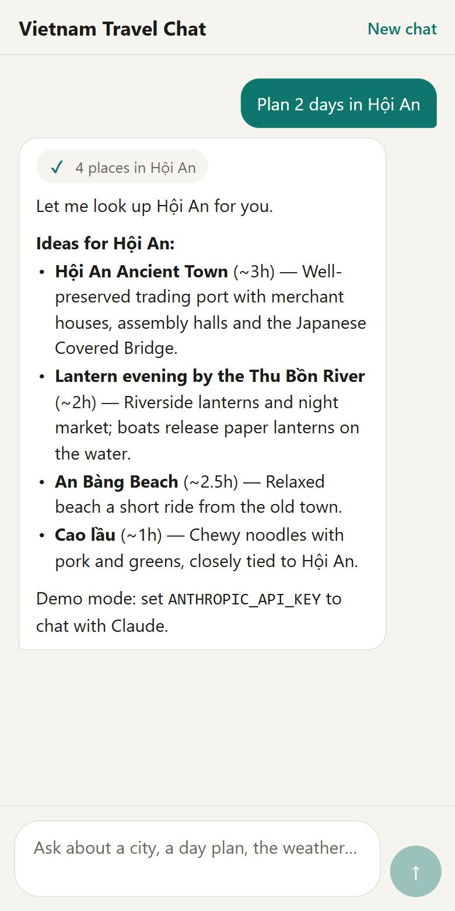
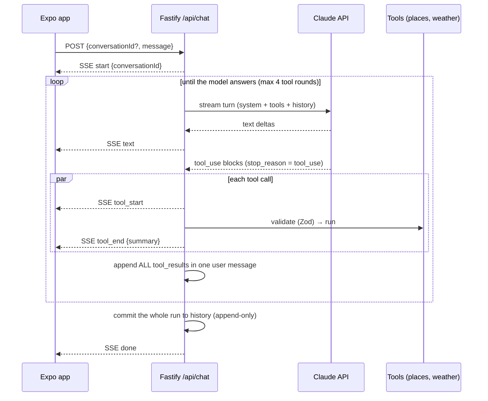

# AI Travel Chat

[](https://github.com/tnKiness/ai-travel-chat/actions/workflows/ci.yml)


A Vietnam travel assistant for iOS, Android and the web. Answers stream in token by token while the assistant looks up places and live weather with **tool calls** — and you can watch each lookup happen.



- **Expo (React Native)** app — one codebase for iOS, Android and web
- **Fastify** server running a hand-written **agent loop** on the **Claude API**
- **Server-Sent Events** from server to app, parsed incrementally on the device
- Tools: curated places database and **live weather** (Open-Meteo)
- Runs **without an API key**: a scripted demo model drives the same loop, tools and UI

> I'm a core contributor to a production travel app with an agentic AI chat. This repository is an independent, from-scratch take on that architecture — no company code.

<br clear="right" />

## How a message flows



## Engineering highlights

| Concern | How it's handled | Code |
|---|---|---|
| Agent loop | Manual loop over streamed turns; handles `tool_use`, `pause_turn`, `max_tokens` (never runs truncated tool input) and `refusal` | [agent.ts](server/src/agent.ts) |
| Runaway tool use | Tool-round budget; past it, the model gets "budget spent" results and must answer | `maxToolRounds` |
| Model safety declines | Server-side `fallbacks: "default"`; after a mid-stream fallback, pre-boundary non-text blocks are dropped before echoing history | [claude.ts](server/src/model/claude.ts), `echoableContent` |
| Untrusted tool input | Tools stream input eagerly, so every input is validated with Zod; failures go back to the model as `is_error` results | [tools/index.ts](server/src/tools/index.ts) |
| Parallel tools | Concurrent execution, all results returned in a single message (keeps parallel calling working) | `runAgent` |
| Consistent history | Append-only; a run is committed only when it completes, so aborts and errors never leave half-turns | [conversations.ts](server/src/conversations.ts) |
| Prompt caching | Fixed tool order + stable system prompt + automatic `cache_control` | [claude.ts](server/src/model/claude.ts) |
| Client disconnects | Closing the app aborts the in-flight Claude request (no tokens wasted) | [app.ts](server/src/app.ts) |
| Concurrency & abuse | One run per conversation (409), per-IP token-bucket rate limit, input length cap, LRU + TTL eviction | [rate-limit.ts](server/src/rate-limit.ts) |
| Streaming on mobile | `expo/fetch` + `ReadableStream`; a shared SSE parser that survives chunks split anywhere, even mid-character | [sse.ts](shared/src/sse.ts), [api.ts](app/src/api.ts) |
| Error messages | Typed SDK errors mapped to safe, user-facing messages with a `retryable` flag | `describeError` |

**43 tests** cover the loop (refusals, truncation, retries, tool budgets, parallel results), the HTTP/SSE layer (streaming, busy conversations, client aborts, rate limits), the SSE parser (every split point) and the app's message state.

## Tech stack

- **App:** Expo SDK 58 · React Native 0.88 · TypeScript
- **Server:** Node.js 22 · Fastify 5 · Anthropic TypeScript SDK · Zod
- **Shared:** event types and SSE parser used by both sides
- **Tooling:** npm workspaces · Vitest · ESLint · GitHub Actions

## Run it

Requires Node.js 22.

```bash
npm install
npm run dev:server   # API on http://localhost:3001
npm run dev:app      # Expo web on http://localhost:8081 (press i / a for simulators)
```

With no `ANTHROPIC_API_KEY` the server uses the offline demo model. To chat with Claude, copy `.env.example` to `.env` and set `ANTHROPIC_API_KEY`. On a physical phone, put `EXPO_PUBLIC_API_URL=http://<your-LAN-IP>:3001` in `app/.env` (Expo reads env files from the app folder).

```bash
npm run check   # lint → typecheck → tests → build server + export web app (same as CI)
```

## Project layout

```text
shared/   ChatEvent types + incremental SSE parser (built to JS, used by server and app)
server/
  src/agent.ts          the agent loop
  src/model/            Claude (Anthropic SDK) and the scripted demo model
  src/tools/            search_places, get_weather (+ curated data)
  src/conversations.ts  append-only history store
  src/app.ts            HTTP + SSE endpoint
app/
  App.tsx               chat screen
  src/useChat.ts        streaming state; src/chat-state.ts pure reducer (tested)
  src/components/       message bubbles, tool chips, composer, tiny Markdown renderer
```

## Next steps

- Persist conversations (Postgres/Redis) so the API can scale horizontally
- Real places API and map view; deep links to directions
- Auth and per-user quotas; usage/cost metrics from `usage` on every turn
- EAS Build profiles for store releases

## License

[MIT](LICENSE) © tnKiness
